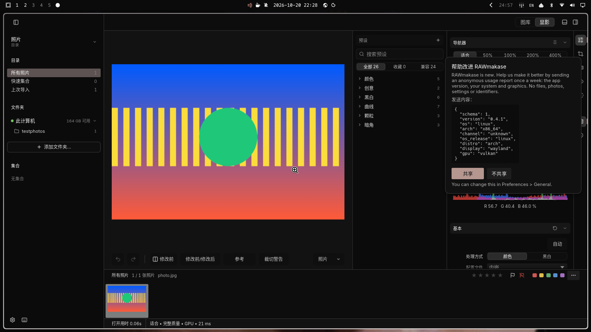

# RAWmakase 中文版 (rawmakase-zh)

给 [RAWmakase](https://github.com/pch/rawmakase) 的简体中文界面：先把图库、显影面板、
预设、首选项、对话框等界面文字完整汉化，再打包成可直接安装的形式。

上游代码**一行未改**——汉化发生在文字排版层：所有被绘制的字符串在
`epaint::Fonts::layout_job` 里先查一张 `英文<TAB>中文` 词典，命中后替换再排版。
因此菜单、按钮、滑块标签、提示、对话框，甚至用 `Painter::text` 直接画的文字都会被
翻译；上游发新版时只需重新编译，不需要重新改代码。



## 特性

- **整界面中文**：图库、显影、蒙版/污点修复、导出、首选项、右键菜单、状态栏。
- **词典外置**：`/usr/share/rawmakase-zh/zh.tsv`，改译文不用重新编译。
- **跟随上游**：`tools/rebuild-zh.sh` 一条命令把任意 tag 重新汉化编译。
- **不碰原版**：与 `rawmakase-bin` 并存，共用目录/预设/设置；卸载只删自己的文件。
- **可回滚**：安装脚本保留上一个二进制为 `rawmakase.prev`。

## 安装

### AUR（推荐）

```sh
yay -S rawmakase-zh        # 或 paru -S rawmakase-zh
```

### 手动构建

```sh
git clone https://github.com/OWNER/rawmakase-zh.git
cd rawmakase-zh
# 需要 Rust 1.98+、libraw、lcms2、clang、pkgconf 和一套中文字体
tools/rebuild-zh.sh latest                 # 克隆上游、打补丁、编译、装到 /usr/local
tools/rebuild-zh.sh latest --no-install    # 只编译，产物留在 src/target/release/
```

## 使用

- 应用菜单里的 **RAWmakase 中文版**，或终端 `rawmakase-zh [照片或目录]`
- 与英文版共用 `~/.local/share/rawmakase/` 下的目录与设置

## 跟随上游更新

```sh
tools/rebuild-zh.sh latest                  # 最新发布
tools/rebuild-zh.sh v0.5.0                  # 指定 tag
tools/rebuild-zh.sh v0.5.0 --prepare-only   # 只验证补丁能否套用（约 20 秒）
```

脚本会：checkout tag → 按该版本的 `Cargo.lock` 取对应 epaint → 注入钩子（幂等，
`layout_job` 签名变化会明确报错）→ 编译 → 校验二进制确实带词典 → 安装（旧版备份）
→ 用 `tools/extract_missing.py` 列出该版本还没有译文的新字符串。

`packaging/rawmakase-zh-update-check.timer`（systemd 用户定时器）每天查一次 GitHub
发布，比本地版本新就发桌面通知；只发一个 `curl`，不消耗任何 API 额度。包安装后启用：

```sh
systemctl --user daemon-reload
systemctl --user enable --now rawmakase-zh-update-check.timer
```

## 参与翻译

词典一行一条，`{e}`、`{}`、`{name}` 这类占位符两侧顺序必须一致，运行时把捕获到的值
填回译文。面板标题在应用里会先转成大写，`build_dict.py` 自动补大写孪生条目。

```
Exposure	曝光
Metadata could not be saved: {e}	元数据无法保存：{e}
```

```sh
python3 tools/extract_missing.py    # 列出还没有译文的字符串 -> zh_new.txt
# 写进 zh_extras.json（或按行号写进 zh_map.json）后重新生成
python3 build_dict.py
sudo install -m644 zh.tsv /usr/share/rawmakase-zh/zh.tsv   # 重启应用即生效
```

## 工作原理

```
上游源码 (pch/rawmakase@tag)
   └── [patch.crates-io] epaint = ./patched/epaint
          └── src/zh.rs：词典 + 模板匹配 + 日志，钩在 Fonts::layout_job
```

- 只处理「整段一次排版」的文字；带选区的文本编辑不动，避免破坏编辑状态。
- 多段式排版（一句话里某个词单独着色）会合并成一段，牺牲强调色保留译文。
- 键位、文件名、相机型号、EXIF 数值保持原样。

## 仓库结构

```
patches/zh.rs          epaint 的词典模块（唯一需要注入的代码）
tools/rebuild-zh.sh    任意 tag 一键重建 + 安装
tools/patch_epaint.py  幂等注入钩子；layout_job 签名变了会报错
tools/patch_cargo.py   写 [patch.crates-io]
tools/extract_missing.py  列出没有译文的字符串
tools/check_update.sh  GitHub 发布检查（给 systemd 定时器用）
zh_map.json / zh_extras.json  译文源文件（按英文原文索引）
build_dict.py          生成 zh.tsv
packaging/             启动脚本、桌面项、安装脚本、systemd 单元
aur/                   PKGBUILD 与 AUR 需要的辅助文件
screenshots/           界面截图
```

## 兼容性

补丁依赖 `epaint` 的 `Fonts::layout_job`。RAWmakase 0.3.3 与 0.4.1 都 pin epaint
0.36.2，补丁原样可用；将来 egui/epaint 大版本升级导致签名变化时，脚本会报错停止，
改 `patches/zh.rs` 适配即可，其余流程不变。

## 卸载

```sh
sudo pacman -Rns rawmakase-zh     # AUR 安装
sudo rm -rf /usr/local/{bin/rawmakase-zh,lib/rawmakase-zh,share/rawmakase-zh,share/applications/rawmakase-zh.desktop}
```

## 许可

本项目（补丁、词典、脚本、打包）以 MIT 发布；RAWmakase 本身也是 MIT，版权归其作者。
本项目是第三方汉化，与 RAWmakase 官方无关。

---

**English**: unofficial Simplified Chinese localization of RAWmakase. Upstream
sources stay untouched: a patched `epaint` translates every laid-out string
through a TSV dictionary at text-layout time, so labels, menus, tooltips, dialogs
and painter-drawn text all follow. Includes `tools/rebuild-zh.sh` to re-localize
any upstream tag, a systemd timer that reports new releases, and an AUR package.
